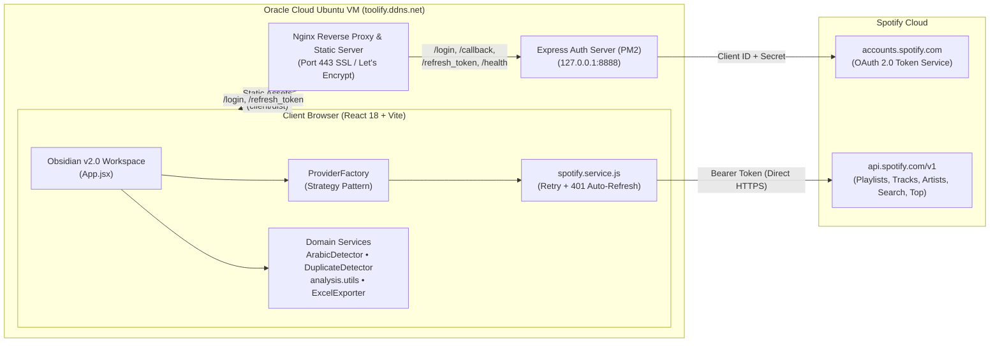
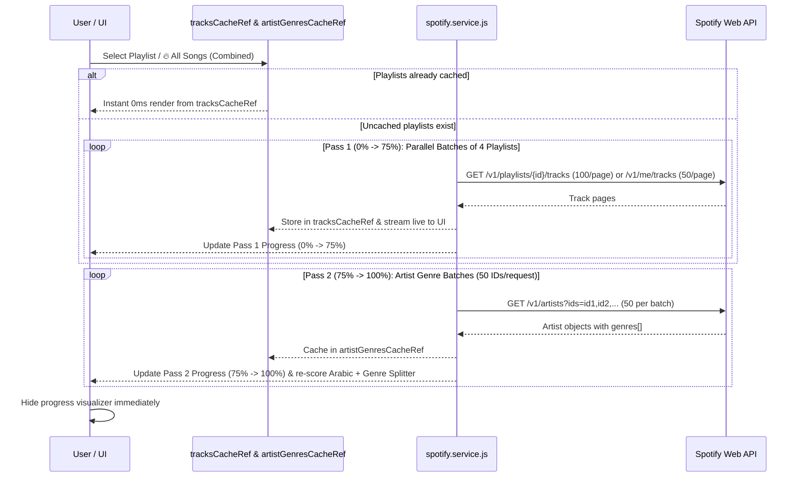
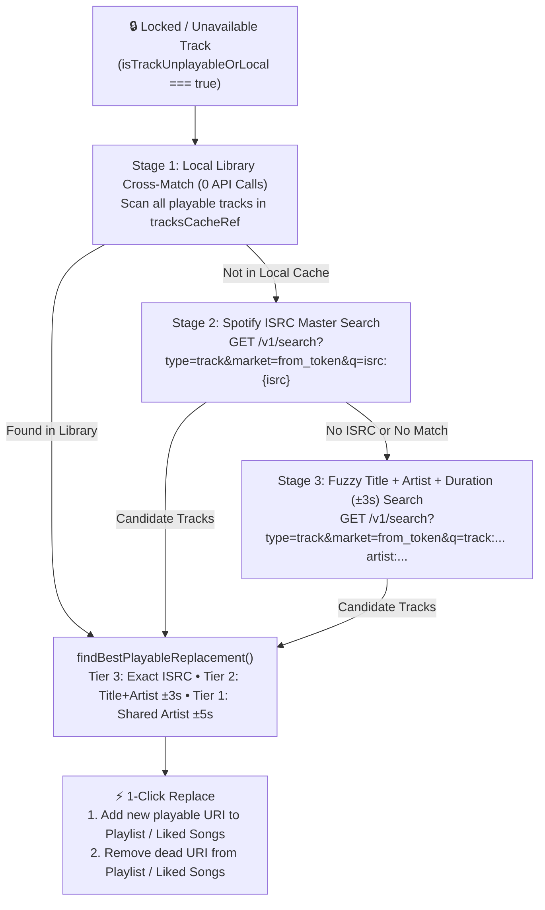

# 🏗️ System Architecture — Spotify Toolkit 2.0

**Last Updated:** November 14, 2026  
**Live Deployment:** [https://toolify.ddns.net](https://toolify.ddns.net)

---

## 1. High-Level System Topology

Spotify Toolkit 2.0 follows a **Stateless Hybrid Client-Server Architecture**:
1. **Express OAuth & Token Broker (`server/`):** Handles Spotify OAuth 2.0 Authorization Code exchange (`/login`, `/callback`), CSRF state validation, and stateless token refresh (`/refresh_token`) using server-side client secrets. Zero user data or tokens are persisted on disk.
2. **React 18 + Vite Obsidian Workspace (`client/`):** Communicates directly with `https://api.spotify.com/v1/*` using the user's bearer token, executing all multi-playlist caching, Arabic 3-pass detection, fuzzy duplicate clustering, playlist set-math, and dead-track replacement in memory.



---

## 2. Frontend Domain & Service Architecture (`client/src/`)

The frontend is structured around **SOLID & Clean Code** principles, separating UI orchestration (`App.jsx`) from pure, unit-tested domain models and services:

```
client/src/
├── models/
│   ├── Track.js                  # Normalized Track entity, composite selection keys & fingerprints
│   └── Playlist.js               # PlaylistModel (Liked Songs virtual playlist, Combined scope, edit guards)
├── providers/
│   └── ProviderFactory.js        # Strategy pattern wrapping spotifyService operations
├── services/
│   ├── spotify.service.js        # All Spotify Web API endpoints, batching, 429 backoff & 401 refresh
│   ├── DuplicateDetector.js      # Strict & Fuzzy (±0-5s) duplicate clustering & composite key extraction
│   ├── ExcelExporter.js          # Builder-pattern .xlsx exporter with HYPERLINK formulas
│   ├── analysis.utils.js         # Top Artists, Decade Timeline, Genre Family Splitter, Compare A/B & 3-Tier Replacement Matcher
│   └── filters/
│       ├── ArabicDetector.js     # 2-Pass / 3-Tier Arabic Script, Franco Keyword, Known Artist & Spotify Genre engine
│       └── TrackSpecifications.js# Specification Pattern (AND/OR composite filter engine)
├── config/
│   └── analysisRegistry.js       # Open/Closed module registry
├── utils/
│   ├── formatters.js             # Duration, date, and release-year formatters
│   └── logger.js                 # Token-redacting 100-entry ring-buffer client logger
└── App.jsx                       # Unified Obsidian v2.0 5-Workflow Workspace
```

---

## 3. Core Engine Workflows & Algorithms

### 3.1 Two-Pass Progressive Library Loading & Genre Enrichment
To prevent the progress bar from stalling at `0%` or `100%` when scanning `3,900+` tracks across `15+` playlists, library analysis is split into two proportional phases (`0% → 75%` and `75% → 100%`):



---

### 3.2 🌙 Arabic Detection Pipeline (`ArabicDetector.js`)
Each track is evaluated by `ArabicDetector.detectTrack(item, { strictMode, artistGenres })`:
1. **Track Title Check:**
   - **Arabic Script (`/[\u0600-\u06FF]/`):** e.g., `"البخت"` $\rightarrow$ `"Arabic Script in Title"`.
   - **Franco-Arabic / Cultural Keyword (`\b` word boundary):** e.g., `"Habibi"`, `"Mahraganat"`, `"Tarab"` $\rightarrow$ `"Keyword: Habibi (Title)"`.
   - **Known Artist in Title:** e.g., `"3abali (feat. Samer Doumet)"` $\rightarrow$ `"Artist Match: samer (in Title)"`.
2. **Artist Array Check:**
   - **Strict Exact-Match Artists:** Disambiguates names like `"Ruby"`, `"Muslim"`, `"Nour"`, `"Sandy"` by requiring an exact case-insensitive artist name match.
   - **Broad Curated Arabic Artists:** Matches `80+` MENA artists (`"Amr Diab"`, `"Cairokee"`, `"Fairuz"`, `"Wegz"`, `"Marwan Pablo"`, etc.).
   - **Arabic Script / Keyword in Artist Name:** Checked only when `strictMode === false`.
3. **Album Name Check:** Checks Arabic script and cultural keywords in `album.name` when `strictMode === false`.
4. **Pass 2 — Spotify Artist Genres (`detectByGenres`):** When `strictMode === false`, checks the track's credited artists against `ARABIC_GENRE_KEYWORDS` (`egyptian pop`, `arab pop`, `mahraganat`, `khaleeji`, `levantine`, `shaabi`, etc.).

---

### 3.3 🧹 Playable-First Duplicate Clustering (`DuplicateDetector.js` + `App.jsx`)
1. **Clustering (`DuplicateDetector.clusterTracks`):**
   - **Scope Partitioning:** In `per` mode (default), tracks are partitioned by `sourcePlaylist.id` so duplicates are only grouped within the same playlist. In `cross` mode, all tracks in the active scope share a single bucket namespace.
   - **Strict vs. Fuzzy Matching:**
     - `strict`: Groups by exact normalized `title|primaryArtist|durationMs` or identical `track.id`.
     - `fuzzy`: Strips edition suffixes (`Remastered`, `Radio Edit`, `feat.`, etc.), groups by `normalizedTitle|normalizedPrimaryArtist`, and merges sub-clusters whose durations are within `±durationTolerance` seconds (default `±2s`).
2. **Playable-First Keep Tie-Breaker (`App.jsx`):**
   - Before applying `Oldest`, `Newest`, or `Popular`, the comparator checks `isTrackUnplayableOrLocal(a) !== isTrackUnplayableOrLocal(b)`.
   - Any playable copy automatically sorts ahead of any locked/unplayable copy, guaranteeing the working version is marked **`KEEP`** and the broken/delisted version is marked **`REMOVE`**.
3. **Occurrence-Safe Deletion:**
   - When deleting duplicates from a playlist where the `KEEP` and `REMOVE` copies share the exact same Spotify URI, the client records `keepItemByPlaylistUri` and re-inserts the preserved copy if Spotify's URI deletion removes all occurrences.

---

### 3.4 🔄 3-Stage Unavailable / Locked Track Replacement Engine (`analysis.utils.js` + `App.jsx`)

When Spotify regional licensing or distributor re-uploads cause a track to become locked (`is_playable === false` or `available_markets: []`), the toolkit locates and swaps in the working version using a 3-stage pipeline:



---

## 4. Production Deployment Architecture (`https://toolify.ddns.net`)

| Layer | Specification |
| :--- | :--- |
| **Compute Instance** | Oracle Cloud `VM.Standard.E2.1.Micro` (`ubuntu@152.67.91.217`, Ubuntu 20.04, 1 GB RAM + 2 GB `/swapfile`) |
| **TLS & Reverse Proxy** | Nginx (`/etc/nginx/sites-available/toolify`) with Let's Encrypt Certbot SSL (`toolify.ddns.net`) |
| **Static Frontend (`Option A`)** | Nginx serves `/home/ubuntu/spotifytoolkit/client/dist` directly with `try_files $uri $uri/ /index.html` |
| **Backend Proxy Routes** | Nginx proxies `/login`, `/callback`, `/api/auth/*`, `/refresh_token`, and `/health` to `http://127.0.0.1:8888` |
| **Process Manager** | PM2 (`spotify-toolkit`) running `server/index.js` (`PORT=8888`, `HOST=127.0.0.1`, `USE_HTTPS=false`) |
| **Automated Verification** | 16 Node test suites (`5` server suites in `server/tests/server.test.js` + `11` client suites in `client/tests/toolkit.test.js`) |
